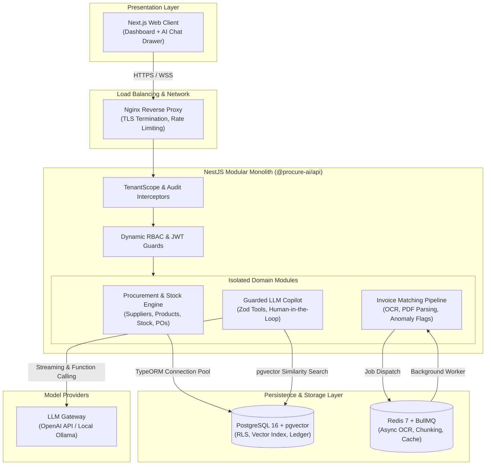

# ProcureAI 🏢 🤖

> **Enterprise-Grade, Multi-Tenant Procurement & Inventory ERP with a Guarded LLM Copilot**  
> *A portfolio project demonstrating production-minded distributed system design, strict multi-tenancy, deterministic concurrency control, and human-in-the-loop AI safety.*

[](https://nodejs.org/)
[](https://pnpm.io/)
[](https://www.typescriptlang.org/)
[](https://nestjs.com/)
[](https://nextjs.org/)
[](https://www.postgresql.org/)
[](https://redis.io/)
[](https://www.docker.com/)

---

## 🎯 Vision & Business Context

Most AI business software falls into one of two traps:
1. **Legacy ERPs**: Massive, rigid, slow, and dependent on manual data entry.
2. **"AI Wrappers"**: Fragile prototypes that expose raw SQL execution or unvalidated tool calling to an LLM, leading to prompt injections, hallucinations, privacy leaks, and corrupted balances.

**ProcureAI** demonstrates how an AI copilot belongs inside a serious enterprise ERP: as an **untrusted reasoning assistant** protected by hard-coded schema validations, deterministic state machines, human-in-the-loop approvals, and triple-layer multi-tenancy isolation.

---

## 🏗️ Monorepo Topology

This repository is organized as a lightweight, clean **pnpm monorepo**:

```
ProcureAI/
├── apps/
│   ├── api/                  # NestJS backend (Modular Monolith)
│   │   ├── src/              # Config, Database, Common kernel, & Domain modules
│   │   └── README.md         # Deep-dive API & module architecture guide
│   └── web/                  # Next.js frontend (ERP Dashboard & Copilot UI)
│
├── packages/
│   └── shared/               # Shared TypeScript types, DTO contracts, & Zod schemas
│
├── docker/                   # Docker Compose services (PostgreSQL, pgvector, Redis)
├── docs/                     # Architecture Decision Records (ADRs), Threat Models
├── pnpm-workspace.yaml       # Monorepo workspace definition
└── tsconfig.base.json        # Unified TypeScript compiler base
```

---

## 🏛️ System Architecture (C4 Container View)



---

## ⚡ Core Engineering Invariants

| Principle | Implementation Details |
|---|---|
| **Zero Raw SQL by LLM** | The AI only invokes whitelisted, strongly-typed tools validated against strict Zod schemas under the authenticated user's RBAC scope. |
| **Human-in-the-Loop** | State-changing operations (issuing POs, approving invoices, updating stock) are created in `DRAFT` status and require human sign-off. |
| **Triple-Layer Multi-Tenancy** | 1. `TenantScopeInterceptor` extracts verified JWT tenant context.<br/>2. Denormalized `tenant_id` on all entities and child lines.<br/>3. PostgreSQL Row-Level Security (RLS) enforcement at the engine level. |
| **Concurrency Safeguards** | **Pessimistic Locking** (`SELECT ... FOR UPDATE`) with deterministic ordering prevents inventory overselling. **Optimistic Locking** (`@VersionColumn()`) on POs/Invoices returns HTTP `409 Conflict` on concurrent collisions. |
| **Fail-Fast Boot Lifecycle** | Pre-boot environment variable validation via Joi. The server refuses to bind to port 3000 if configuration is invalid. |
| **Strict Money Pattern** | Financial and inventory figures are strictly stored as integer minor units (`4999` for `$49.99`) + ISO 4217 currency code. |

---

## 🗺️ Engineering Roadmap (Phased Build)

- [x] **Phase 1: Foundation Setup**
  - [x] Monorepo workspace skeleton (`pnpm-workspace.yaml`, `tsconfig.base.json`)
  - [x] NestJS API scaffold (`apps/api`)
  - [x] Fail-fast typed configuration module with Joi validation
  - [ ] TypeORM PostgreSQL connection layer (`synchronize: false`, connection pooling)
  - [ ] Multi-tenant domain entities: Tenant, User, Role, Supplier, Product, StockLevel, PO, Invoice, AuditLog
  - [ ] Dynamic RBAC join tables & Tenant-scoping infrastructure
- [ ] **Phase 2: LLM Gateway**
  - Provider interface (OpenAI / Ollama), streaming, retries, fallback models, prompt versioning, and cost/latency logging.
- [ ] **Phase 3: Retrieval-Augmented Generation (RAG)**
  - Document chunking, vector embeddings with `pgvector`, tenant-isolated similarity search, answers with citations.
- [ ] **Phase 4: Agent & Guarded Tool Calling**
  - Function calling with Zod validation, prompt-injection defenses, and approval queues.
- [ ] **Phase 5: Invoice Processing Pipeline**
  - PDF upload, OCR queue with BullMQ, 3-way PO matching, and anomaly flag detection.
- [ ] **Phase 6: Multi-Provider Payments & Ledger**
  - Double-entry bookkeeping (accounts & entries), idempotent webhooks, and provider adapters.
- [ ] **Phase 7: Frontend Application (`apps/web`)**
  - Next.js dashboard, inventory views, PO workflows, and interactive AI copilot drawer.
- [ ] **Phase 8: High Concurrency & Scalability**
  - Concurrency tests (proving no overselling), monthly table partitioning, and k6 performance benchmarks.

---

## 🚀 Quickstart & Local Setup

### 1. Prerequisites
- **Node.js**: `>= 24.0.0`
- **pnpm**: `>= 9.0.0`
- **Docker & Docker Compose**

### 2. Setup
```bash
# Clone repository
git clone https://github.com/MohamedFarouk9/ProcureAI.git
cd ProcureAI

# Install all workspace dependencies
pnpm install

# Copy environment template
cp .env.example .env

# Spin up database and cache containers
docker compose up -d postgres redis

# Run database migrations
pnpm --filter @procure-ai/api run typeorm migration:run -- -d src/database/data-source.ts
```

### 3. Running Applications
```bash
# Start backend API (NestJS watch mode)
pnpm dev
# API listening at http://localhost:3000
```

### 4. Monorepo Scripts
| Command | Description |
|---|---|
| `pnpm dev` | Runs the API server in hot-reload development mode |
| `pnpm build` | Compiles all apps and shared packages |
| `pnpm test` | Runs unit tests across all workspace packages |
| `pnpm test:e2e` | Runs end-to-end integration tests |
| `pnpm lint` | Runs ESLint code-quality checks |

---

## 📚 Deep-Dive Documentation

- [Backend API Architecture Guide](apps/api/README.md) — Comprehensive technical reference for `AppModule`, boot lifecycle, and module design.
- [Architecture Decision Records (ADRs)](docs/adr/) — Technical trade-offs and rationale behind our stack decisions.
- [Threat Model](docs/threat-model.md) — Security analysis of multi-tenancy, prompt-injection vectors, and RLS policies.

---

## 🛡️ License & Disclaimer

This project is licensed under the MIT License.  
*Disclaimer: Payments and financial integrations run in sandbox/test mode only. No real payment card data or funds are processed.*
