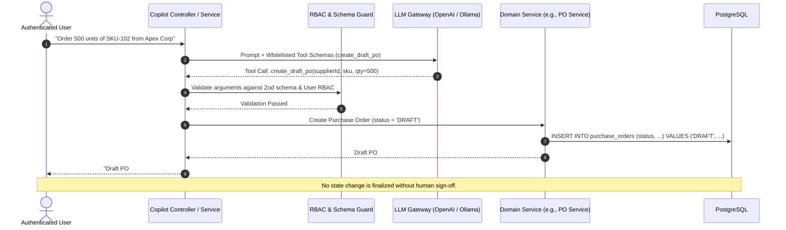

# ProcureAI — Core API Backend (`@procure-ai/api`)

[](https://nodejs.org/)
[](https://pnpm.io/)
[](https://nestjs.com/)
[](https://www.postgresql.org/)
[](https://redis.io/)
[](LICENSE)

> **Enterprise-grade, multi-tenant Procurement & Inventory ERP with a guarded LLM copilot.**  
> Built as a modular monolith demonstrating production-grade distributed system patterns: fail-fast lifecycles, pessimistic/optimistic concurrency control, transactional outbox, double-entry ledger, and safe AI execution.

---

## Table of Contents

1. [Project Overview & Business Domain](#1-project-overview--business-domain)
2. [Key Architecture Highlights](#2-key-architecture-highlights)
3. [Technology Stack](#3-technology-stack)
4. [Module Structure & Bounded Contexts](#4-module-structure--bounded-contexts)
5. [The LLM Copilot: Safe Function Calling](#5-the-llm-copilot-safe-function-calling)
6. [Security & Multi-Tenancy Defense-in-Depth](#6-security--multi-tenancy-defense-in-depth)
7. [Data Integrity & Concurrency Controls](#7-data-integrity--concurrency-controls)
8. [Local Development & Setup](#8-local-development--setup)
9. [Database & Migrations](#9-database--migrations)
10. [Testing Strategy](#10-testing-strategy)
11. [Configuration Reference](#11-configuration-reference)

---

## 1. Project Overview & Business Domain

Traditional ERPs are rigid, slow, and require extensive manual data entry. Conversely, most modern "AI ERPs" are fragile wrappers that connect raw LLMs to SQL databases—creating massive security, privacy, and hallucination risks.

**ProcureAI** bridges this gap:
- **Core ERP Functionality:** End-to-end procurement lifecycle from supplier onboarding, product cataloging, and real-time inventory tracking to purchase order (PO) approvals and automated 3-way invoice matching.
- **Safe AI Copilot:** A context-aware assistant capable of answering natural-language inventory queries (RAG with citations) and proposing actions (drafting POs, updating reorder thresholds).
- **Zero Rogue Executions:** The AI **never** runs raw SQL and cannot commit state changes autonomously. Every AI proposal is created as a `DRAFT` requiring explicit human approval.

---

## 2. Key Architecture Highlights

- **Modular Monolith:** Clean domain boundaries isolated into NestJS modules. Provides single-process ACID transactions without the distributed latency and complexity of premature microservices.
- **Triple-Layer Multi-Tenancy:**
  1. *Application Layer:* `TenantScopeInterceptor` injects authenticated `tenant_id` into all queries.
  2. *Data Layer:* Denormalized `tenant_id` on all entities (including line items).
  3. *Engine Layer:* PostgreSQL Row-Level Security (RLS) enforcing tenant isolation at the database level.
- **Deterministic Boot Sequence:** Type-safe, fail-fast configuration via `@nestjs/config` and Joi. If an environment variable is missing or malformed, the application aborts on startup before opening network ports.
- **Strict Money Pattern:** Financial and inventory values are stored as integer minor units (`4999` for `$49.99`) paired with ISO 4217 currency codes to eliminate floating-point arithmetic errors.

---

## 3. Technology Stack

| Layer | Technology | Rationale |
|---|---|---|
| **Framework** | NestJS 11 (TypeScript) | Enterprise-grade IoC, strict dependency injection, and modular structure |
| **Database** | PostgreSQL 16 + `pgvector` | Relational integrity for ledger/orders + native high-performance vector search |
| **ORM** | TypeORM 0.3.x | Mature TypeScript ORM, full migration tooling, fine-grained transaction control |
| **Caching & Queues**| Redis 7 + BullMQ | Reliable asynchronous job processing (invoice OCR, document chunking, embeddings) |
| **AI / LLM** | OpenAI API / Local Ollama | Model-agnostic interface with streaming, fallbacks, and token/cost telemetry |
| **Validation** | Joi & Zod | Strict schema validation for environment configuration and AI tool arguments |
| **Testing** | Jest + Supertest | Unit testing, repository mocks, integration testing, and concurrency tests |

---

## 4. Module Structure & Bounded Contexts

The backend is organized into decoupled bounded contexts:

```
apps/api/src/
├── app.module.ts                 # Composition root (wires infrastructure + domains)
├── main.ts                       # Entrypoint (pipes, filters, interceptors, Swagger)
│
├── config/                       # Configuration context
│   ├── config.module.ts          # Dynamic global config registration
│   ├── configuration.ts          # Structured config factory
│   └── env.validation.ts         # Fail-fast Joi schema
│
├── database/                     # Persistence context
│   ├── database.module.ts        # TypeORM async connection pool provider
│   ├── data-source.ts            # Standalone DataSource for CLI migrations
│   └── migrations/               # Deterministic SQL migrations
│
├── common/                       # Shared kernel
│   ├── decorators/               # @CurrentUser(), @TenantId(), @Roles()
│   ├── guards/                   # JwtAuthGuard, RolesGuard, TenantGuard
│   ├── interceptors/             # TenantScopeInterceptor, AuditInterceptor
│   ├── filters/                  # GlobalHttpExceptionFilter
│   └── middleware/               # CorrelationIdMiddleware, RequestLogger
│
└── modules/                      # Domain modules
    ├── auth/                     # JWT authentication, refresh tokens, passport strategies
    ├── tenants/                  # Tenant lifecycle, subscriptions, and isolation config
    ├── users/                    # User management & dynamic RBAC (Role/Permission join)
    ├── suppliers/                # Supplier registry, payment terms, and ratings
    ├── products/                 # Product catalog, SKU generation, pricing
    ├── stock/                    # Multi-warehouse stock levels, reservations, reorders
    ├── purchase-orders/          # PO state machine (Draft -> Approved -> Received)
    ├── invoices/                 # Invoices, OCR pipeline, PO matching, anomaly flags
    ├── audit/                    # Immutable, append-only audit trail
    ├── llm-gateway/              # Provider abstraction, retries, cost/latency telemetry
    ├── rag/                      # Document ingestion, pgvector embeddings, citation engine
    └── copilot/                  # Agent orchestrator, whitelisted tools, approval queue
```

---

## 5. The LLM Copilot: Safe Function Calling

ProcureAI treats the LLM as an **untrusted reasoning engine**. The architecture enforces strict boundaries:



### Safety Rules
1. **Zero Dynamic SQL:** The LLM cannot query the database directly. All interactions go through strongly typed TypeScript methods.
2. **Deterministic Schemas:** Arguments are strictly validated via Zod schemas before hitting business logic.
3. **Draft-Only State Changes:** State-altering operations (approving payments, issuing POs, adjusting stock) only create drafts requiring human confirmation.
4. **Auditability:** Every tool invocation logs the prompt version, model, latency, token count, cost, and caller identity.

---

## 6. Security & Multi-Tenancy Defense-in-Depth

```
  ┌─────────────────────────────────────────────────────────────┐
  │  Layer 1: TenantScopeInterceptor                            │
  │  Extracts validated tenant_id from JWT on every request     │
  └──────────────────────────────┬──────────────────────────────┘
                                 │
  ┌──────────────────────────────▼──────────────────────────────┐
  │  Layer 2: Denormalized Keys                                 │
  │  Every entity & child line carries tenant_id directly       │
  └──────────────────────────────┬──────────────────────────────┘
                                 │
  ┌──────────────────────────────▼──────────────────────────────┐
  │  Layer 3: PostgreSQL Row-Level Security (RLS)               │
  │  Database engine enforces tenant_id = current_setting(...)  │
  └─────────────────────────────────────────────────────────────┘
```

- **Authentication:** Stateless JWTs with short-lived access tokens (15m) and secure refresh tokens stored in Redis.
- **Dynamic RBAC:** Roles (e.g., `ADMIN`, `MANAGER`, `BUYER`, `VIEWER`) are mapped to granular permissions (`po:create`, `po:approve`, `stock:read`) via join tables, allowing per-tenant customization.
- **PII Redaction:** Sensitive vendor or employee details are scrubbed prior to dispatching prompts to external LLM providers.

---

## 7. Data Integrity & Concurrency Controls

ProcureAI is designed to withstand high-concurrency enterprise workloads:

- **Inventory Oversell Prevention:**
  Stock reservation uses pessimistic locking:
  ```sql
  SELECT * FROM stock_levels 
  WHERE product_id = :productId AND warehouse_id = :warehouseId 
  FOR UPDATE;
  ```
  Transactions enforce a consistent lock ordering across multiple items to prevent deadlocks.
- **Optimistic Locking:**
  `PurchaseOrder` and `Invoice` entities feature an integer `@VersionColumn() version`. Concurrent writes detect state conflicts and return `409 Conflict` payloads rather than overwriting changes.
- **Double-Entry Ledger:**
  Financial transactions maintain balancing credit and debit entries stored as minor units. Ledger transactions execute under `SERIALIZABLE` isolation with automated retry mechanisms.

---

## 8. Local Development & Setup

### Prerequisites
- **Node.js**: `>= 24.0.0`
- **pnpm**: `>= 9.0.0`
- **Docker & Docker Compose** (for PostgreSQL + Redis)

### Installation

1. **Clone the repository:**
   ```bash
   git clone https://github.com/MohamedFarouk9/ProcureAI.git
   cd ProcureAI
   ```

2. **Install monorepo dependencies:**
   ```bash
   pnpm install
   ```

3. **Configure Environment:**
   ```bash
   cp .env.example .env
   ```
   *(Ensure placeholders in `.env` match your local PostgreSQL and Redis credentials)*.

4. **Start Infrastructure Containers:**
   ```bash
   docker compose up -d postgres redis
   ```

5. **Start the API in watch mode:**
   ```bash
   pnpm --filter @procure-ai/api run start:dev
   ```

6. **Verify Server Status:**
   Open [http://localhost:3000/api/health](http://localhost:3000/api/health) in your browser.

---

## 9. Database & Migrations

In accordance with enterprise standards, `synchronize: false` is enforced across all environments. All schema migrations are version-controlled and executed via TypeORM CLI.

```bash
# Run pending migrations
pnpm --filter @procure-ai/api run typeorm migration:run -- -d src/database/data-source.ts

# Generate a new migration from entity changes
pnpm --filter @procure-ai/api run typeorm migration:generate src/database/migrations/MigrationName -- -d src/database/data-source.ts

# Revert the last migration
pnpm --filter @procure-ai/api run typeorm migration:revert -- -d src/database/data-source.ts
```

---

## 10. Testing Strategy

The test suite is structured to prove system invariants and zero-leakage guarantees:

```bash
# Run unit tests (services with mocked repositories)
pnpm --filter @procure-ai/api run test

# Run integration tests (end-to-end API flows with real database)
pnpm --filter @procure-ai/api run test:e2e

# Run test coverage report
pnpm --filter @procure-ai/api run test:cov
```

### Critical Test Suites
- **Tenant Isolation Tests:** Proves that Tenant A queries can never read or mutate Tenant B records, even with crafted IDs.
- **Concurrency Oversell Tests:** Simulates 50 parallel reservation requests against 10 available units of stock; verifies that exactly 10 succeed and 40 fail cleanly.
- **Ledger Invariant Tests:** Asserts that every financial posting maintains `SUM(debits) - SUM(credits) === 0`.

---

## 11. Configuration Reference

All environment variables are validated at boot time via [`apps/api/src/config/env.validation.ts`](file:///d:/ProcureAI/apps/api/src/config/env.validation.ts):

| Variable | Type | Default | Description |
|---|---|---|---|
| `NODE_ENV` | String | `development` | Environment mode (`development`, `production`, `test`) |
| `PORT` | Number | `3000` | HTTP port for the API server |
| `DATABASE_HOST` | String | *Required* | PostgreSQL host address |
| `DATABASE_PORT` | Number | `5432` | PostgreSQL port |
| `DATABASE_NAME` | String | *Required* | Database name |
| `DATABASE_USER` | String | *Required* | Database username |
| `DATABASE_PASSWORD` | String | *Required* | Database password |
| `REDIS_HOST` | String | `localhost` | Redis host for caching and BullMQ queues |
| `REDIS_PORT` | Number | `6379` | Redis port |
| `JWT_SECRET` | String | *Required* | Secret key for JWT signing (minimum 32 characters) |
| `JWT_EXPIRATION_SECONDS` | Number | `3600` | Access token time-to-live in seconds |
